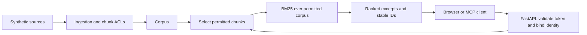

# VaultSearch
### Permission-aware search with inspectable evidence

Search a synthetic company knowledge base as a configured persona, inspect the original excerpts, and compare what different identities may retrieve.

**Python · FastAPI · BM25 · Vanilla JavaScript · MCP**

Optional experiments: FAISS, sentence-transformers, Ollama and LocalStack.

[Run the demo](#run-locally) · [Case study](docs/case-study.md) · [Architecture](docs/architecture.md) · [Demo walkthrough](docs/demo.md) · [Measured evidence](reports/portfolio_evidence.json)

## What this project demonstrates

- **Permissions before ranking.** The API derives identity from a server-configured bearer token and restricts search to permitted chunks. A caller cannot select a different persona.
- **Evidence you can inspect.** Results include complete excerpts, source identifiers and document/chunk IDs.
- **A reproducible identity comparison.** General staff and finance personas receive different permitted evidence for the same budget query.
- **Useful behavior without a model.** Keyword search works locally without a GPU, Ollama, embeddings or a reranker.
- **Explicit failure states.** Invalid credentials, unavailable generation, absent evidence and withheld drafts are distinct.
- **Tool integration.** MCP tools forward requests to the same authenticated API.

The included dataset has **225 synthetic documents, 513 chunks and 12 personas**. It includes fabricated restricted facts and hostile instructions for evaluation; no real workplace data is required.

## Run locally

Use Python 3.12 for the documented validation environment. Extract the curated source ZIP or open the project checkout, then run these commands from the project root. Reuse an existing virtual environment if one is already configured.

**Windows / PowerShell**

```powershell
python -m venv .venv
.\.venv\Scripts\python.exe -m pip install -r requirements-search.txt
.\.venv\Scripts\python.exe run_demo.py --user ines
```

**Linux / macOS**

```bash
python3 -m venv .venv
.venv/bin/python -m pip install -r requirements-search.txt
.venv/bin/python run_demo.py --user ines
```

Open **http://127.0.0.1:8000**, paste the token printed by the launcher into **Demo token**, and select **Connect**. Search **paid time off**, then open a source excerpt.

Stop the server with Ctrl+C. Restart with `--user dmitri` and reconnect using the fresh token to demonstrate finance access. Use `--port 8001` if the default port is occupied. The browser keeps the token in page memory.

Python 3.11+ is the declared baseline; the recorded native validation used Python 3.12. Dependency installation requires network access. Linux/macOS and CI execution have not yet been confirmed for this snapshot.

## See the permission boundary

| Step | Persona | Query | What to inspect |
|---|---|---|---|
| 1 | Ines, general staff | paid time off | Permitted policy text and source IDs |
| 2 | Ines, general staff | Q3 infrastructure budget | No finance-only budget evidence |
| 3 | Dmitri, finance | Q3 infrastructure budget | Permitted budget evidence |
| 4 | Either | zygomorphic quasar | Clear empty-result state |

A missing result makes no claim about whether restricted documents exist. The operator changes identities by restarting the server; the UI cannot impersonate another user.

## Architecture



The optional generated-answer path adds retrieval, source selection, model calls, citation filtering and draft presentation. It remains experimental. [Read the design decisions](docs/architecture.md).

## Evidence and reproducibility

The October 22 extracted-package validation recorded:

| Check | Result | Scope |
|---|---|---|
| Lightweight regression suite | 176 passed | Excludes model-loading integration tests |
| Permission corpus comparisons | 9 stable; 0 differences | BM25, full non-timing search responses |
| Scripted acceptance cases | 8 completed | Actual API/retrieval; scripted model outputs |
| HTTP and MCP integration | Passed | Local API plus real MCP stdio client/server |

These are local engineering checks, not production security or live-model quality claims. [Evidence summary](reports/portfolio_evidence.json) · [Detailed release review](reports/release_review.md)

```powershell
.\.venv\Scripts\python.exe -m pip install -r requirements-test.txt
.\.venv\Scripts\python.exe redteam/release_check.py
```

Node.js is required for the JavaScript syntax check. Each run creates a new local evidence directory. A [CI workflow](.github/workflows/ci.yml) is prepared for Windows and Linux; it has not yet run on GitHub. [Validation guide](docs/validation.md)

## Scope and remaining work

**Supported portfolio demo:** local keyword search, server-bound demo identities, source inspection, and MCP forwarding.

**Experimental:** generated answers, semantic retrieval/reranking, Docker and LocalStack. The recent embedding check exceeded its deadline; Docker runtime and named desktop MCP hosts remain unverified. Historical live-model findings are inconclusive and include unsafe answers. The output detector can miss attacks and withhold legitimate security quotations.

Production identity providers, confidential workplace deployment, scalability and comprehensive prompt-injection resistance are outside the validated scope. [Full technical reference](docs/reference.md) · [Bounded evaluation guide](RUN_SECURITY.md)

## Explore the code

| Area | Files |
|---|---|
| Identity and permissions | `app/auth.py`, `app/acl.py` |
| Search and evidence | `app/retrieval_core.py`, `app/tools.py` |
| API and browser | `app/api.py`, `web/` |
| Optional generation | `app/agents.py`, `app/presentation.py` |
| MCP | `mcp_server.py` |
| Validation and packaging | `tests/`, `redteam/release_check.py`, `redteam/build_release.py` |

The portfolio demo runs locally. See the validation guide to reproduce its checks.
